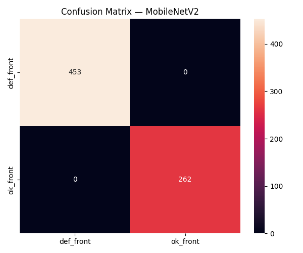
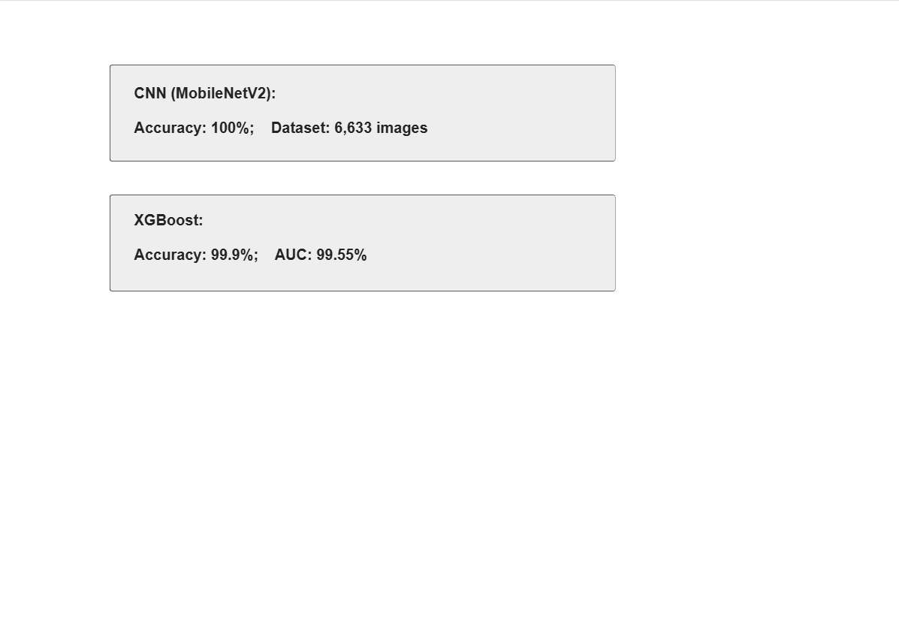
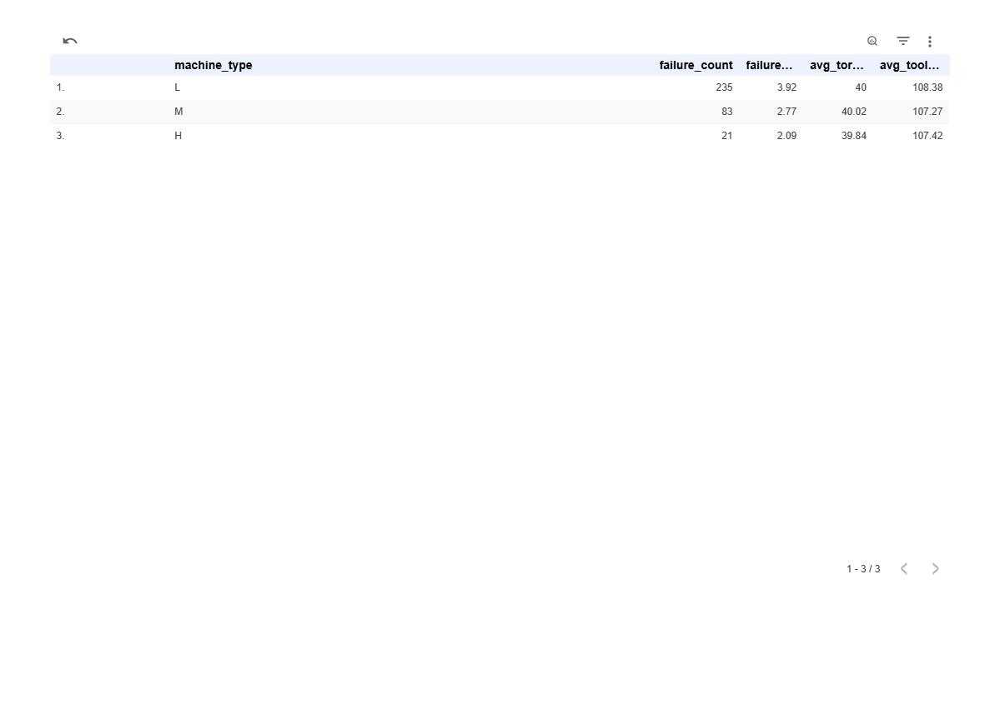
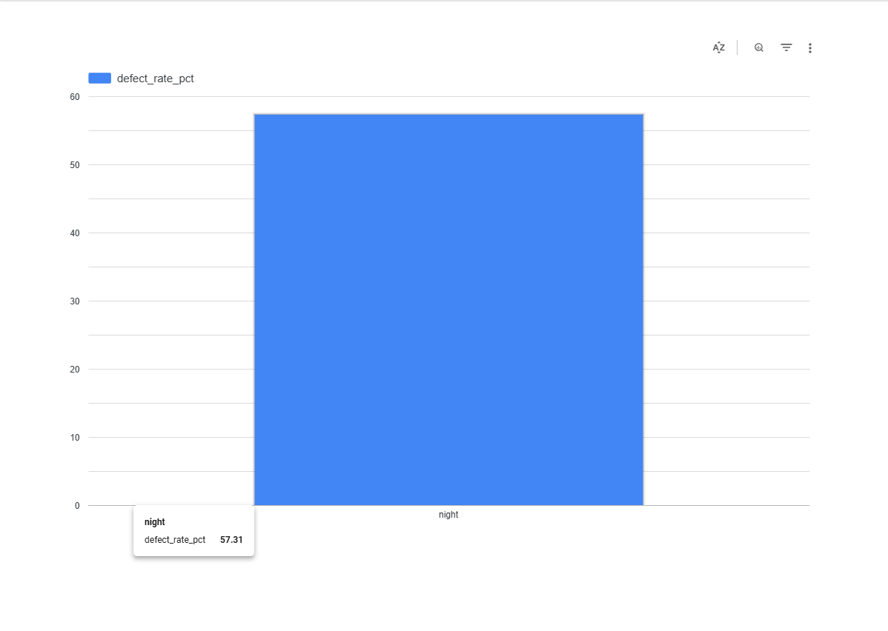
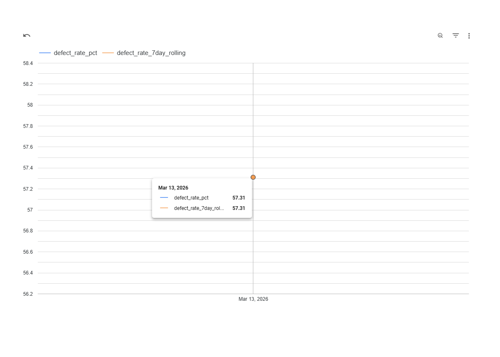

# Foundry Defect Detection & Production Quality Pipeline

> An end-to-end ML quality inspection pipeline inspired by a computer vision system developed and deployed for a metal-casting manufacturer in Belagavi, India, during my time at Hamdan InfoCom.

> **Note:** This repository independently recreates the visual inspection workflow using public casting images and extends it with XGBoost-based equipment failure prediction, SHAP explainability, and Looker Studio dashboards built from separate public sensor datasets.

## Live Demo

| | |
|---|---|
| 🖥️ **Demo UI** | https://foundry-defect-api-241173171739.us-central1.run.app/ui |
| 📡 **API Docs** | https://foundry-defect-api-241173171739.us-central1.run.app/docs |
| 📊 **Dashboard** | https://lookerstudio.google.com/reporting/772148c6-c390-42a6-9c28-3ea3d2109d5e |

Upload any casting image to the Demo UI and get a live defect prediction — no setup required.

---

## Business Context

A small metal-casting manufacturer in Belagavi relied on manual visual inspections to identify defective machine components before shipment. This labor-intensive process was susceptible to human error, allowing defective products to pass quality checks.

During my time at Hamdan InfoCom, we developed and deployed a computer vision-based inspection system that delivered measurable operational improvements:

- **Quality Improvement:** Reduced inspection error rates by 11 percentage points, from 13% to 2%.
- **Workforce Optimization:** Reallocated 10 of 12 inspection technicians to production while retaining 2 for final verification.
- **Financial Impact:** Generated approximately $8,400 in observed monthly cost savings.

**Data Confidentiality:** The original client's production datasets are protected under NDA and are not included in this repository.

This repository independently recreates the visual inspection workflow using public casting images and extends it with XGBoost-based equipment failure prediction, SHAP explainability, and Looker Studio dashboards using separate public sensor datasets.

All model performance and inference benchmarks presented in this repository refer to the portfolio reconstruction, not the original factory deployment.

---

## Architecture

```
Raw Data Sources
      │
      ▼
┌─────────────────────────────────────────┐
│         Apache Airflow (Docker)         │
│  DAG 1: Casting images → GCS + BigQuery │
│  DAG 2: SECOM sensors  → BigQuery       │
│  DAG 3: AI4I equipment → BigQuery       │
└─────────────────┬───────────────────────┘
                  │
                  ▼
┌─────────────────────────────────────────┐
│         dbt Core (foundry_quality)      │
│  Staging: stg_casting, stg_secom,       │
│           stg_ai4i                      │
│  Marts:   mart_inspection_summary       │
│           mart_shift_analysis           │
│           mart_process_health           │
│           mart_defect_features          │
└─────────────────┬───────────────────────┘
                  │
                  ▼
┌─────────────────────────────────────────┐
│              ML Layer                   │
│  CNN: MobileNetV2 (casting images)      │
│  XGBoost: Process anomaly (AI4I)        │
│  Experiment tracking: MLflow            │
└─────────────────┬───────────────────────┘
                  │
                  ▼
┌──────────────────────────────────────────────────┐
│  Serving Layer — FastAPI on GCP Cloud Run        │
│  /ui  — drag-and-drop demo interface             │
│  /predict — REST endpoint for image inference    │
└──────────────────────────────────────────────────┘
                  │
                  ▼
┌─────────────────────────────────────────┐
│         Looker Studio Dashboard         │
│  Defect trend │ Shift analysis          │
│  Process health │ Model performance     │
└─────────────────────────────────────────┘
```

**Infrastructure:** GCP (BigQuery + GCS + Cloud Run) · Docker · Python 3.8

---

## Datasets

| Dataset | Source | Role |
|---|---|---|
| Casting Product Image Data | Kaggle (ravirajsinh45) | 7,340 real grayscale images from PILOT TECHNOCAST foundry — defective vs. ok pump impellers (~85MB in GCS) |
| SECOM Semiconductor Sensors | UCI ML Repository | 1,567 rows · 590 sensor signals with pass/fail labels — proxy for furnace/mold process parameters |
| AI4I 2020 Predictive Maintenance | UCI ML Repository | 10,000 factory sensor records with equipment failure labels — process anomaly detection |

---

## Pipeline Phases

### Phase 1 — Environment Setup
- Docker + Airflow via Docker Compose
- GCP project with BigQuery and GCS APIs enabled
- GCS buckets: `foundry-pipeline-raw/`, `foundry-pipeline-processed/`
- dbt Core project init, MLflow, GitHub repo

### Phase 2 — Data Ingestion (Airflow DAGs)
Three scheduled DAGs with data quality checks (null rates, row counts, label distribution):
- `dag_casting_ingestion` — casting images → GCS, metadata → BigQuery
- `dag_secom_ingestion` — SECOM sensor data → BigQuery
- `dag_ai4i_ingestion` — AI4I equipment data → BigQuery

### Phase 3 — Transformation Layer (dbt)
7 models across staging and mart layers, all tests passing:
- **Staging:** `stg_casting_metadata`, `stg_secom`, `stg_ai4i`
- **Marts:** `mart_inspection_summary` (daily defect rates + 7-day rolling trend), `mart_shift_analysis` (defect rate by shift), `mart_process_health` (equipment failure by machine type), `mart_defect_features` (ML-ready feature table)

### Phase 4 — ML Layer

#### CNN Defect Classifier (MobileNetV2)
- Transfer learning on 7,340 real foundry inspection images
- Training: 6,633 images · Validation: 715 images (used as held-out test set)
- Device: CUDA (RTX 4060)

| Metric | Value |
|---|---|
| Accuracy | **100%** |
| Precision (def_front) | 1.00 |
| Recall (def_front) | 1.00 |
| F1-Score | 1.00 |
| TP / TN / FP / FN | 453 / 262 / 0 / 0 |

#### Process Anomaly Detector (XGBoost + SHAP)
- Trained on 10,000 AI4I sensor records from BigQuery
- Features: air temperature, process temperature, rotational speed, torque, tool wear
- 80/20 train/test split, stratified
- Failure type sub-flags excluded to prevent data leakage (see note below)

| Metric | Value |
|---|---|
| Accuracy | **98.55%** |
| AUC | **97.26%** |
| Precision (failure) | 0.87 |
| Recall (failure) | 0.68 |

> **Note on leakage prevention:** Failure type flags (twf, hdf, pwf, osf, rnf) are sub-components of the target variable `machine_failure` and were deliberately excluded. Including them yielded 99.9% accuracy but constituted data leakage — the honest sensor-only result is 98.55%.

**SHAP Feature Importances (Top SHAP contributors to predicted equipment failure):**

| Feature | Importance |
|---|---|
| torque_nm | 1.191 |
| tool_wear_min | 1.070 |
| rotational_speed_rpm | 0.734 |
| air_temperature_k | 0.733 |
| process_temperature_k | 0.335 |

Both experiments tracked in MLflow under the `foundry_defect_detection` experiment.

### Phase 5 — Serving, Dashboard & Documentation
- **FastAPI model server** deployed on GCP Cloud Run — `/ui` drag-and-drop demo, `/predict` REST endpoint
- Cold start latency: ~22s (Cloud Run scale from zero) · Warm inference: ~230ms
- Looker Studio dashboard (4 pages): Defect Trend, Shift Analysis, Process Health, Model Performance

---

## Key Findings

**Visual Defect Detection**
- MobileNetV2 achieved 100% classification accuracy on the reported 715-image held-out benchmark set (453 TP, 262 TN, 0 FP, 0 FN), demonstrating strong performance under the evaluated conditions. Generalization to new production environments requires additional validation.

**Equipment Failure Prediction**
- XGBoost achieved 98.55% accuracy and 97.26% ROC-AUC on the AI4I predictive maintenance dataset, with 0.68 recall for equipment failures.
- Machine type L exhibited the highest observed failure rate (3.92%), followed by M (2.77%) and H (2.09%) in the benchmark dataset.

**Explainable AI**
- SHAP analysis identified torque, tool wear, and rotational speed among the strongest contributors to predicted equipment failures, providing interpretable signals for further investigation.
- These associations are based on public equipment sensor data and do not establish causal relationships with casting defects at the original foundry.

**Model Validation**
- Excluded failure-type indicators derived from the target variable to prevent data leakage in the XGBoost model.
- The results demonstrate benchmark performance; further testing with representative, independently labeled production data would be necessary to establish factory-specific reliability.

---

## Portfolio Results & Potential Applications

This portfolio reconstruction demonstrates an end-to-end ML quality inspection architecture inspired by an industrial computer vision deployment.

**Demonstrated Capabilities**
- **Automated Inspection:** MobileNetV2 achieved 100% accuracy on the reported 715-image benchmark evaluation set, demonstrating the feasibility of automated visual defect classification under controlled test conditions.
- **Predictive Maintenance:** XGBoost achieved 98.55% accuracy and 97.26% ROC-AUC using public equipment sensor records.
- **Explainability:** SHAP analysis and Looker Studio dashboards provide insights into model predictions, equipment failure patterns, and quality-related metrics.
- **Cloud Inference:** Deployed a FastAPI inference service on GCP Cloud Run, achieving approximately 230 ms warm inference latency, with scale-to-zero capability.
- **Modular Architecture:** Integrated Airflow, dbt Core, BigQuery, GCS, and MLflow to demonstrate reproducible data processing, model development, and cloud deployment.

**Potential Industrial Applications**

The architecture could support automated visual inspections, earlier identification of equipment anomalies, reduced manual inspection workloads, and data-driven quality monitoring.

Actual deployment would require factory-specific validation, integration with inspection hardware, reliability testing, and appropriate human oversight.

**Scope:** The public casting images and equipment sensor datasets are independent benchmark sources. They do not represent synchronized measurements from the original manufacturing environment. The reconstruction's performance metrics should not be interpreted as operational results from the original client deployment.
---

## Screenshots

### Demo UI — Live on Cloud Run


### Confusion Matrix — MobileNetV2


### Looker Studio Dashboard





---

## Tech Stack

| Layer | Tools |
|---|---|
| Orchestration | Apache Airflow 2.x (Docker) |
| Storage | GCP GCS + BigQuery |
| Transformation | dbt Core |
| ML — Vision | PyTorch 2.4, torchvision, MobileNetV2 |
| ML — Tabular | XGBoost 2.1, SHAP 0.44 |
| Experiment Tracking | MLflow 2.17 |
| Model Serving | FastAPI, GCP Cloud Run |
| Dashboard | Looker Studio |
| Infrastructure | Docker, Python 3.8, CUDA 12.1 |

---

## Project Structure

```
foundry-defect-pipeline/
├── airflow/
│   └── dags/
│       ├── dag_casting_ingestion.py
│       ├── dag_secom_ingestion.py
│       └── dag_ai4i_ingestion.py
├── dbt/
│   └── foundry_quality/
│       └── models/
│           ├── staging/
│           └── marts/
├── notebooks/
│   └── ml/
│       ├── train_cnn.py
│       ├── train_xgboost.py
│       └── serve/
│           ├── main.py
│           ├── Dockerfile
│           └── requirements.txt
├── mlflow/
│   └── models/
│       ├── best_mobilenetv2.pth
│       ├── best_xgboost.json
│       ├── confusion_matrix_cnn.png
│       ├── confusion_matrix_xgboost.png
│       └── shap_summary.png
├── docs/
│   └── screenshots/
├── data/
│   └── raw/
├── docker-compose.yml
└── README.md
```

---

## Future Work

- **Model drift monitoring** — in production, incoming casting images would be monitored for distribution shift using Evidently AI. A significant drift score would trigger automated retraining and redeployment via a Cloud Build / GitHub Actions CI/CD pipeline
- **Cloud Composer** — migrate Airflow DAGs from local Docker to managed Cloud Composer for production-grade scheduling and monitoring
- **Airflow → Cloud Run retraining DAG** — scheduled weekly retraining pipeline that pulls new inspection images from GCS, retrains the CNN, evaluates against holdout set, and redeploys to Cloud Run only if accuracy improves
- **SECOM feature integration** — enrich the XGBoost model with full SECOM sensor signals (590 features) for deeper process anomaly detection

---

*Developed by Shridhar Sunilkumar Pol as an independent portfolio reconstruction, inspired by an industrial quality inspection system originally deployed during his tenure at Hamdan InfoCom, Belagavi, India.*
